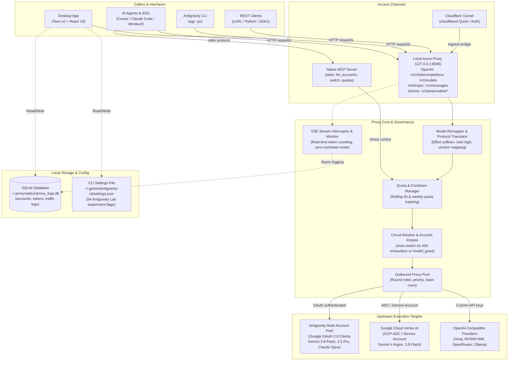
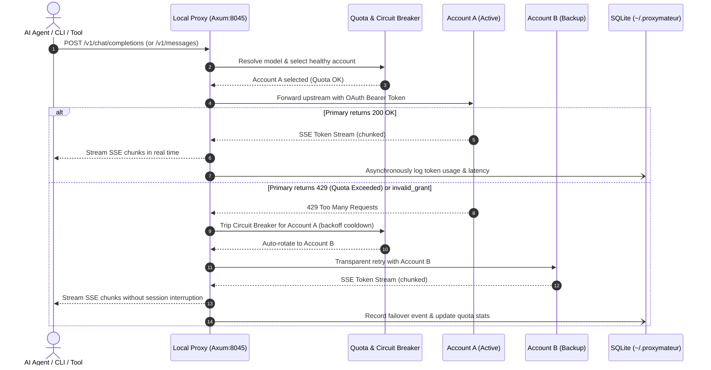

# Proxymateur-Clean

[](LICENSE)
[](https://github.com/yuatemycat/Proxymateur-Clean/releases)
[](https://v2.tauri.app/)
[](https://www.rust-lang.org/)
[](https://react.dev/)
[](https://www.typescriptlang.org/)

**A desktop app for people who use Google Antigravity with more than one account.**

It shows how much quota each account has left, lets you switch between accounts, and runs a small local server so other tools (the Antigravity CLI, Cursor, Claude Code, or anything that speaks the OpenAI or Anthropic API) can use those accounts. It also has a settings page for Antigravity's experiment flags.

It's built with Rust, Tauri v2 and React, and it's a fork of [lbjlaq/Antigravity-Manager](https://github.com/lbjlaq/Antigravity-Manager), changed a lot and maintained by [yuatemycat](https://github.com/yuatemycat).

You bring your own Google OAuth credentials (see [setup below](#bring-your-own-google-oauth-credentials)). I looked for analytics or crash-reporting libraries (Sentry, PostHog, Mixpanel, Amplitude, Google Analytics, Datadog, OpenTelemetry) in the dependencies and source and found none.

---

## What it does

- **Tracks quota per account.** Rolling 5-hour and weekly quotas, shown per model, so you can see who has room left.
- **Switches accounts** from the app, from a command-line tool, or from another AI agent.
- **Runs a local proxy** on `127.0.0.1:8045` that accepts OpenAI-style, Anthropic-style and Gemini-style requests.
- **Offers an MCP server** (`proxymateur mcp`) so agents like Cursor or Claude Code can check quotas and switch accounts.
- **Routes to other providers**: Vertex AI with your own GCP credentials, or any OpenAI-compatible endpoint (presets for NVIDIA NIM, Groq, OpenRouter and Ollama).
- **Keeps you out of trouble**: low-quota alerts, a circuit breaker, a pool of outbound proxies, and an optional Cloudflare tunnel.
- **Lets you flip Antigravity experiment flags** from a settings page (more on that [further down](#antigravity-lab-experiment-flags)).

---

## Pick how you want to use it

| I want to... | Run this | Needs the background proxy? |
| :--- | :--- | :---: |
| See and manage my accounts and quotas | the desktop app: `proxymateur` | No |
| Use the Antigravity CLI through my accounts | `agy -px "..."` (plain `agy` runs normally) | Yes, for `-px` |
| Let Cursor / Claude Code / another agent check quotas and switch accounts | `proxymateur mcp` | No |
| Give other tools an OpenAI / Anthropic / Gemini-style endpoint | `proxymateur --headless` | It is the proxy |

---

## How it fits together

### 1. System Architecture & Component Topology



### 2. Request Lifecycle & Automatic Failover



Account data and settings are stored locally in SQLite under `~/.proxymateur`. The CLI settings the app edits live in `~/.gemini/antigravity-cli/settings.json`.

---

## Quick start

### A. The desktop app

```bash
proxymateur
```

Things worth opening first:

- **Accounts**: quotas and countdowns for every account.
- **Agent Proxy → API Proxy**: port, routing, circuit breaker, tunnel.
- **Observability → Traffic Logs** and **Token Stats**: what went through the proxy and how many tokens it used.
- **Settings → OpenAI Models**: add other providers.
- **Settings → Account**: low-quota alerts.
- **Settings → Advanced → Antigravity Lab**: the experiment-flag toggles.

### B. The Antigravity CLI

The repo includes a wrapper script (`scripts/agy_gateway.ps1`) around `agy`. By default it runs `agy` normally. Add `-px` to send the request through your local proxy instead:

```bash
agy "Audit this repository for race conditions"      # normal
agy -px "Run the full regression tests"              # through the proxy
```

There are also extra slash commands (`/swarm`, `/owl`, `/battle` and more). They are added by a patch script, so read the [Antigravity Lab](#antigravity-lab-experiment-flags) section before using them.

### C. As an MCP server

Add this to your agent's MCP config (Cursor: `.cursor/mcp.json`, Antigravity: `~/.gemini/config/mcp_config.json`, Claude Desktop: `claude_desktop_config.json`):

```json
{
  "mcpServers": {
    "proxymateur": {
      "command": "proxymateur",
      "args": ["mcp"]
    }
  }
}
```

It offers seven tools:

| Tool | What it does |
| :--- | :--- |
| `list_accounts` | Lists accounts with their tier and Gemini / Claude quota |
| `read_quotas` | Detailed per-model quota and reset times |
| `get_current_account` | Which account is active |
| `switch_account` | Switches the active account |
| `get_proxy_status` | Whether the proxy is running, its port, and how many accounts are available |
| `list_proxy_accounts` | Accounts in the proxy rotation and whether each is enabled |
| `toggle_proxy_account` | Enables or disables an account in the rotation, by email |

More detail is in [`docs/CLI_MCP_GUIDE.md`](docs/CLI_MCP_GUIDE.md).

### D. Headless (no window)

```bash
proxymateur --headless
```

This starts the proxy without the desktop window. The port comes from the saved config (default 8045). There is no `--port` flag. Headless mode reads a few environment variables: `ABV_API_KEY`, `ABV_WEB_PASSWORD`, `ABV_AUTH_MODE`, `ABV_BIND_LOCAL_ONLY` and `ABV_DATA_DIR`.

To stop a running instance:

```bash
curl -X POST http://127.0.0.1:8045/system/shutdown
```

API details are in [`docs/API_REFERENCE.md`](docs/API_REFERENCE.md).

---

## Antigravity Lab (experiment flags)

**Settings → Advanced → Antigravity Lab** has toggles for 54 Antigravity experiment flags. Your choices are written to `~/.gemini/antigravity-cli/settings.json`, where the CLI reads them.

### Empirical Runtime Verification & Binary Proofs

Controlled A/B testing and x86_64 disassembly of `agy.exe` (207MB Go binary) establish that Antigravity experiment flags are **not static prompt decorators** (a single-turn prompt generates an identical 60KB system instruction regardless of flag state). Instead, they are **compiled event-driven runtime logic gates** in Go that sleep until their specific execution event triggers:

```
┌────────────────────────────────────────────────────────────────────────────────────────────────────────┐
│                                 THE TOP 9 MISSION-CRITICAL RUNTIME FLAGS                               │
├─────────────────────────────────────┬──────────────────────────────────────────┬───────────────────────┤
│ Flag Key                            │ Go Function & Disassembly Entrypoint     │ Operational Role      │
├─────────────────────────────────────┼──────────────────────────────────────────┼───────────────────────┤
│ disable-teamwork-forced-flash-model │ InvokeSubagentTool.launch (0x14232a819)  │ Prevents Flash forced │
│                                     │                                          │ downgrade on subagent │
│ enable-programmatic-tools           │ cortex/core/tools.NewRunWorkflowTool     │ On-the-fly ephemeral  │
│                                     │ (0x142389ed4)                            │ tool & script synthesis│
│ enable-battle-mode                  │ (*CascadeManager).ValidateBattleMode     │ Colosseum adversarial │
│                                     │ (0x1424d2718)                            │ subagent arena gate   │
│ enable-fork-with-subagents          │ (*CascadeManager).allowForkWithSubagents │ Isolated git worktree │
│                                     │ (0x1424ebddb)                            │ subagent sandboxing   │
│ enable-command-assessor             │ cortex/config.CommandAssessorEnabled     │ DeepMind neural shell │
│                                     │ (0x1418594d3)                            │ safety classifier     │
│ enable-command-antivirus            │ cortex/config.augmentConversationalConfig│ Destructive shell cmd │
│                                     │ (0x141857aa5)                            │ heuristic scanner     │
│ enable-compact-slash-command        │ cortex/slashcommands.init (0x14215e9bf)  │ Unlocks /compact &    │
│                                     │ prehooks.NewContextSummaryHook           │ context pruner hook   │
│ enable-cost-accumulator             │ cortex/config.augmentConversationalConfig│ Multi-turn token &    │
│                                     │ (0x1423d7644)                            │ cache cost tracker    │
│ jetski-autonomous-mode              │ cortex.supportedExperiments [9]          │ Suppresses interactive│
│                                     │ (0x14c0d01f0 -> 0x14c141a08)             │ pauses for hands-free │
└─────────────────────────────────────┴──────────────────────────────────────────┴───────────────────────┘
```

#### Detailed Binary Proofs & Trigger Mechanics

1. **Subagent Model Preservation (`disable-teamwork-forced-flash-model`)**
   - *Binary Proof:* At `0x14232a819` (`InvokeSubagentTool.launch`) and `0x14237a2b8` (`InvokeSubagentHandler.Handle`), the binary queries the flag via `runtime.mapaccess2_faststr`. If `false` or missing, execution jumps to `0x14232a87f` and executes `mov dword ptr [rdx+4Ch], 3` (hardcoded internal enum for Gemini Flash). When `true`, it bypasses the assignment, allowing child agents to retain Pro, Ultra, or Opus tiers.
   - *Telemetry Proof:* 147 of 170 spawned subagents across 472 session transcripts retained their parent tier instead of being forced to Flash.

2. **On-The-Fly Tool Synthesis (`enable-programmatic-tools`)**
   - *Binary Proof:* At `0x142389ed4`, `runtime.mapaccess2_faststr` tests `"enable-programmatic-tools"`. If false (`bl == 0`), execution jumps to `0x142389f99`, skipping tool instantiation. When `true`, it loads the `NewRunWorkflowTool` descriptor at `0x14a51e948` and injects `run_workflow` into the session.
   - *Telemetry Proof:* Attributed across 11 benchmark simulation runs for headless script execution and frame profiling.

3. **Colosseum Battle Arena (`enable-battle-mode`)**
   - *Binary Proof:* At `0x1424d2718`, `(*CascadeManager).ValidateBattleMode` loads `"enable-battle-mode"` and executes `call rdx` (IsExperimentEnabled). If not enabled, the method rejects execution with an unauthorized battle session error.
   - *Telemetry Proof:* Coordinates two rival subagents in an adversarial arena to debate implementations and benchmark code.

4. **Git Worktree Sandboxing (`enable-fork-with-subagents`)**
   - *Binary Proof:* At `0x1424ebddb`, `(*CascadeManager).allowForkWithSubagents` queries `"enable-fork-with-subagents"`. If missing or unconfigured, it returns 0 (`xor eax, eax`). When `true`, `invoke_subagent` calls specifying `Workspace: "branch"` provision isolated git worktrees instead of mutating the parent tree.

5. **DeepMind Safety Classifier (`enable-command-assessor`)**
   - *Binary Proof:* At `0x1418594d3`, `cortex/config.CommandAssessorEnabled` tests `"enable-command-assessor"`. If `0`, it immediately exits with `xor eax, eax` (disabled). If `1`, it verifies `!IsExperimentEnabled("disable-command-assessor")` at `0x1418594f8`. Gates terminal commands against DeepMind's safety boundary model.

6. **Destructive Command Interceptor (`enable-command-antivirus`)**
   - *Binary Proof:* At `0x141857aa5`, `augmentConversationalConfigWithExperiment` evaluates `"enable-command-antivirus"`. If `true`, it calls `0x141855f80` to initialize the heuristic scanner and executes `mov byte ptr [rax+28h], 1` (marking Antivirus Active). Intercepts dangerous patterns (`rm -rf /`, fork bombs, drop tables) prior to execution by `run_command`.

7. **Context Compactor & Summary Prehook (`enable-compact-slash-command`)**
   - *Binary Proof:* Referenced at both `0x14215e9bf` (`cortex/slashcommands.init.func2`) and `0x14224d0ab` (`prehooks.NewContextSummaryHook`). When enabled, registers the `/compact` command and hooks token consumption prehooks to prune chat histories crossing window thresholds.

8. **Token Cost & Cache Accumulator (`enable-cost-accumulator`)**
   - *Binary Proof:* Evaluated at `0x1423d7644` in `augmentConversationalConfigWithExperiment` and `0x1424ebcdb` in `CascadeManager`. If missing, branches to `0x1423d7725` (bypassing tracking). When active, monitors exact multi-turn token metrics and prompt caching hits.
   - *Telemetry Proof:* Corroborated in `~/.proxymateur/proxy_logs.db` with 147,004,268 input tokens and 124,001,721 cached prompt tokens tracked.

9. **Hands-Free Autonomous Execution (`jetski-autonomous-mode`)**
   - *Binary Proof:* Entry [9] in the `cortex.supportedExperiments` internal table at `.data` VA `0x14c141a08` (raw offset `0xc140468`), controlled by the slice header at `.data` VA `0x14c0d01f0` (raw `0xc0cebf0`, len 22). When present in `settings.json`, `augmentConversationalConfigWithExperiment` injects autonomous execution flags into the session configuration, suppressing confirmation stops.

### Cleaned Canonical Flags vs. Dead Weight

Configuration audits revealed that `agy.exe` exclusively parses `kebab-case` keys. The settings have been pruned:
- **Pruned 17 dead & imposter flags:** `enable-voice-activity-events` (proven to be an unrelated field from Google Cloud Speech Protobuf), `enable-citc-workspace-hygiene-rule` (Google-internal CitC rule), `scheduled-tasks-v2`, `sidecar-iframe-prewarm`, and unreferenced `enable-customization-kind-*` placeholders (subsumed by `enable-plugins`).
- **Pruned 34 redundant `snake_case` aliases:** Removed duplicate keys (`disable_teamwork_forced_flash_model`, `enable_subagent_hub`, etc.) that bloated `settings.json`.
- **42 verified canonical flags retained:** Actively mapped to named Go functions in the `agy.exe` symbol table.

The extra slash commands (`/swarm`, `/owl`, `/battle`, `/benchmark`, `/generative_ui`, `/compact` and a few aliases) come from `scripts/auto_patch_agy.py`, which **patches `agy.exe` itself** to add them. That edits Google's program. It can break when Antigravity updates, and you do it at your own risk, so keep a backup. Skill definitions for them are in [`skills/`](skills/).

The evidence, with the function names, the command tables and the usage counts, is in **[docs/ANTIGRAVITY_LAB.md](docs/ANTIGRAVITY_LAB.md)**. It separates facts read from the binary from counts taken from the author's own transcripts, and it says where it can't tell.

---

## Other providers and routing

### OpenAI-compatible upstreams

Under **Settings → OpenAI Models** you can add any OpenAI-compatible endpoint. There are presets for NVIDIA NIM, Groq, OpenRouter and a local Ollama. A button tests whether an endpoint is reachable and how long it takes to answer.

- **Effort suffixes.** For `o1`, `o3`, `o4`, `gpt-5` and `gpt-oss` models, add `-low`, `-medium` or `-high` to the model name and it's sent as the `reasoning_effort` setting.
- **DeepSeek.** The same suffixes switch between `deepseek-chat` and `deepseek-reasoner`.
- **Prefix routing.** Requests whose model starts with `openai/` (or a prefix you choose) skip the Google accounts and go to your default OpenAI-compatible upstream.

### Routing mode

`gateway_routing_mode` has two values:

- `all`: every supported model goes through the proxy.
- `argon_only`: only Gemini 4 Argon goes through the proxy (via Vertex). Everything else uses your normal accounts directly.

### Vertex AI

You can send requests to your own Google Cloud project instead of a personal account, using Application Default Credentials or a service-account JSON.

- `default` mode sends Gemini 3.8 Flash to Vertex.
- `picker` mode lets you choose models and map names, with wildcards (for example `gemini-2.5-* -> gemini-2.5-pro`).
- The preference setting (`vertex_first` or `accounts_first`) decides which side to try first.

### Cloudflare tunnel

You can expose the local proxy through `cloudflared`. **Quick** mode needs no setup. **Auth** mode uses your own tunnel token. HTTP/2 is on by default and can be turned off.

### Outbound proxy pool

If your outgoing traffic goes through proxies, you can set up a pool with five selection strategies: `round_robin`, `random`, `priority`, `least_connections` and `weighted_round_robin`. Proxies that keep failing health checks are set aside for a while.

### Alerts and the circuit breaker

You can set low-quota alerts at thresholds you choose. The circuit breaker can stop using an account when its quota reaches zero, then try it again after a backoff, which avoids a flood of 429 errors on unattended runs.

---

## Bring your own Google OAuth credentials

Proxymateur-Clean needs your own Google Cloud OAuth client.

### 1. Create the credentials

1. Open the [Google Cloud Console](https://console.cloud.google.com/) and create a project.
2. Go to **APIs & Services → OAuth consent screen**. Choose **External** (or **Internal** if you use Google Workspace), and add these scopes:
   - `openid`
   - `https://www.googleapis.com/auth/cloud-platform`
   - `https://www.googleapis.com/auth/userinfo.email`
   - `https://www.googleapis.com/auth/userinfo.profile`
   - `https://www.googleapis.com/auth/cclog`
   - `https://www.googleapis.com/auth/experimentsandconfigs`
3. Add your own Google address under **Test users**.
4. Go to **APIs & Services → Credentials → Create credentials → OAuth client ID**. Pick **Desktop app**, or **Web application** with the redirect URIs `http://localhost:8080/oauth-callback` and `http://127.0.0.1:8080/oauth-callback`.
5. Copy the Client ID and Client Secret.

### 2. Give them to the app

**In the app:** **Settings → OAuth Configuration → Add Client**, paste the ID and secret, and give it a label.

**Or with environment variables:**

```bash
# Linux / macOS
export ANTIGRAVITY_OAUTH_CLIENTS="personal|CLIENT_ID.apps.googleusercontent.com|CLIENT_SECRET|Personal Account"
export ANTIGRAVITY_OAUTH_CLIENT_KEY="personal"

# Windows (PowerShell)
[System.Environment]::SetEnvironmentVariable('ANTIGRAVITY_OAUTH_CLIENTS', 'personal|CLIENT_ID.apps.googleusercontent.com|CLIENT_SECRET|Personal Account', 'User')
```

---

## Build from source

You need Node.js and npm, a stable Rust toolchain, and a C++ build toolchain (Visual Studio C++ Build Tools on Windows, `build-essential` on Linux).

```bash
git clone https://github.com/yuatemycat/Proxymateur-Clean.git
cd Proxymateur-Clean
npm install
npm run tauri dev
```

For a release build:

```bash
# Windows
build_exe.bat

# Linux / macOS
npm run build
cd src-tauri && cargo build --release
```

The binary ends up in `src-tauri/target/release/` (`proxymateur.exe` on Windows).

---

## Troubleshooting

- **Claude quota shows 0% but Gemini shows 100%.** That's normal. Gemini and Claude/other-provider quotas are separate pools, and Claude's weekly quota runs out quickly in heavy CLI sessions. The app is meant to keep treating that account as usable for Gemini.
- **Port 8045 is already in use.** Another instance is holding it. Stop it with `curl -X POST http://127.0.0.1:8045/system/shutdown`, or end the process (`Stop-Process -Name "proxymateur" -Force` on Windows).
- **A new Windows build doesn't seem to take effect.** Windows keeps the old executable running. Quit Proxymateur from the system tray (or stop the process as above) before starting the new one.
- **`/swarm`, `/owl` or `/battle` aren't recognized.** Install the skill definitions with `.\skills\install_skills.ps1` (Windows) or `bash skills/install_skills.sh` (Linux/macOS), and make sure you applied the patch described in the Lab section.

## Known limitations

- **Workspace OAuth clients.** If your consent screen is **Internal** inside a Google Workspace, people outside that domain can't sign in with it. Use **External** with a test-user list instead.
- **Opus 5.5 sorting.** In the CLI and MCP account lists, accounts whose label contains "Opus 5.5" are always sorted to the bottom.

---

## Repository layout

```
src/            React 19 frontend (Tailwind, DaisyUI, Ant Design 5)
src-tauri/      Tauri v2 backend and the Axum proxy
  src/commands/   Tauri IPC command handlers
  src/models/     Rust data models
  src/proxy/      Proxy engine, protocol adapters, OpenAI-compatible upstream, token manager
scripts/        Helper scripts (agy_gateway.ps1, auto_patch_agy.py, benchmark_antigravity_lab.py)
skills/         Skill definitions for the extra slash commands (owl, battle, swarm, benchmark, ...)
docs/           Guides, API reference, and the Antigravity Lab evidence
```

---

## Support

This is an independent open-source project. If it saves you time and you'd like to say thanks:

**USDT (BEP20 / BNB Smart Chain):**

```
0xd08d47bde441888166b801616754c667672cd502
```

---

## License and disclaimer

> [!IMPORTANT]
> **Proxymateur-Clean is an independent open-source developer tool and is NOT affiliated with, authorized, maintained, sponsored, or endorsed by Google LLC, Alphabet Inc., or Anthropic PBC.**
>
> "Google", "Antigravity", "Gemini", and "Google Cloud" are registered trademarks of Google LLC. "Claude" is a registered trademark of Anthropic PBC. All brand and product names are trademarks or registered trademarks of their respective holders.

This project is licensed under [Creative Commons Attribution-NonCommercial-ShareAlike 4.0 International (CC BY-NC-SA 4.0)](https://creativecommons.org/licenses/by-nc-sa/4.0/).

- **Original work:** forked from [lbjlaq/Antigravity-Manager](https://github.com/lbjlaq/Antigravity-Manager), © 2024–2026 lbjlaq.
- **This edition:** substantially modified and maintained by [yuatemycat](https://github.com/yuatemycat).
- **Non-commercial and ShareAlike:** you may share and adapt this work for non-commercial purposes if you give credit and release derivative works under the same license.

© 2026 yuatemycat and contributors.
