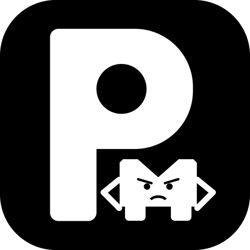

# Proxymateur-Clean 🚀

> **Clean Account & Quota Studio for Antigravity (Non-Proxy, Community Edition)**
>
> An open-source, privacy-first desktop workspace designed for managing Google Antigravity accounts, monitoring real-time quotas, inspecting usage telemetry, and managing sessions — with zero 3rd-party proxy services, zero tracking, and pure client-side Bring-Your-Own (BYO) credentials.
>
> Forked from [lbjlaq/Antigravity-Manager](https://github.com/lbjlaq/Antigravity-Manager) (CC BY-NC-SA 4.0). Substantially modified, refactored, and maintained by [Yuatemycat](https://github.com/yuatemycat).

<div align="center">
  
  <h3>Proxymateur-Clean</h3>
  <p>Clean, sovereign account studio & quota inspector for Google Antigravity</p>

  <p>
    
    
    
    
    
  </p>

  <p>
    <a href="#-key-features">Key Features</a> • 
    <a href="#-bring-your-own-byo-oauth-20-setup">BYO OAuth Guide</a> • 
    <a href="#-local-antigravity-db-import">Local DB Import</a> • 
    <a href="#-installation--build">Installation</a> • 
    <a href="#-support--donations">Support & Donations</a> • 
    <a href="#-disclaimer">Disclaimer</a>
  </p>
</div>

---

## 🌟 Overview

**Proxymateur-Clean** is a community-driven, non-proxy fork engineered specifically for developers who demand complete sovereignty over their Google credentials, quota monitoring, and local AI agent workflows.

Unlike commercial relays or bloated proxies, **Proxymateur-Clean**:
- 🛡️ **Zero Hardcoded OAuth Secrets**: You supply your own Google Cloud OAuth 2.0 Client credentials (BYO OAuth).
- 🚫 **No Background Proxy Services**: Does not hijack local ports or automatically spin up background proxy listeners on startup.
- 🔒 **100% Local Data**: All tokens and session databases remain strictly on your local disk (`rusqlite`), protected by local OS-level encryption.
- 📊 **Decoupled Quota Analytics**: Clear visualization of independent quota pools (Gemini 2.5 Pro, Flash, Thinking, and 3P Claude limits) without cross-contamination.

---

## 🔓 Unlocked Antigravity Capabilities & Reversed Internal Flags

> *"I burned through a mountain of tokens reverse-engineering Antigravity's binaries (`language_server.exe` & `agy.exe`) so you don't have to. This clean release exposes the best hidden flags and advanced multi-agent workflows while remaining 100% sovereign, private, and TOS-safe."*

### ⚡ Feature Matrix (Clean Release vs. Private Build)

| Capability / Feature | Clean Release (This Repo) | Personal Private Build | Why It's a Game-Changer |
|---|:---:|:---:|---|
| **Account Switcher + Smart Warmup** | ✅ **Included** | ✅ | Automatically warms up idle accounts to refresh 5-hour rolling and 7-day weekly reset pools without waiting for usage drops. |
| **Reversed Internal Flags (`--enable-...`)** | ✅ **Included** | ✅ | Unlocks hidden engine capabilities: `--enable-deepagent`, `--enable-review`, `--enable-command-antivirus`, `--disable-teamwork-forced-flash-model`, `--enable-subagent-hub`, `--enable-persistent-terminals`, `--enable-browser-subagent-v2`. |
| **`/swarm` (Next-Gen Multi-Agent Hub)** | ✅ **Included** | ✅ | Hands-free autonomous execution replacing `/teamwork-preview`. Never halts for trivial confirmations; mandates an internal **Tester / Verifier** self-healing loop; and keeps the parent context clean. |
| **`/owl` (Challenger-Synthesizer Engine)** | ✅ **Included** | ✅ | Dual-agent pipeline (`DeepInvestigator` + `DeepCoder`). Doesn't just replace 'A' to fix problem 'B'—it adversarially attacks edge cases (*"what if X, Y, Z, or F happen?"*), validates invariants and compiler gates, then delivers surgical patches. |
| **`/battle` (Colosseum Arena Duel)** | ✅ **Included** | ✅ | Pits 2 rival subagents against each other to build competing architectures, cross-critique flaws, and run empirical benchmarks to crown a victor. |
| **`/benchmark` (Hardware Telemetry)** | ✅ **Included** | ✅ | Replaces guesswork with empirical hardware telemetry: dynamically synthesizes ad-hoc stress-test harnesses to measure p99 latency and ops/sec. |
| **`/compaction` + Auto Token Governor** | ✅ **Included** | ✅ | Interactive slider (50k–500k tokens) and reactive history folding to eliminate latency spikes and prevent context exhaustion. |
| **Real-Time Terminal Status Line** | ✅ **Included** | ✅ | Live terminal telemetry showing active model, context window usage (`ctx: 45.2k (4.4% of 1M)`), and rolling generation throughput (`88 tok/s`) using Hermes-style timestamp math. |
| **Asynchronous Non-Blocking MCP** | ✅ **Included** | ✅ | `--enable-mcp-non-blocking-turn-load` loads MCP tool schemas asynchronously in the background so turns never freeze on slow servers. |
| **Native Stdio MCP Server** | ✅ **Included** | ✅ | Built-in `proxymateur mcp` allows external AI agents (Claude Code, Cursor, OpenCode, Antigravity) to query quotas and hot-swap accounts mid-session. |
| ~~**Auto JB / Persona Injection**~~ | ❌ *Excluded* | 🔒 *Private* | Strikethrough-ed to maintain complete compliance with upstream terms. |
| ~~**Reverse Proxy Relay (Port 8045)**~~ | ❌ *Excluded* | 🔒 *Private* | Stripped out: no local relay port, no traffic interception, pure direct BYO OAuth. |
| ~~**Virtual Custom Model Spoofing**~~ | ❌ *Excluded* | 🔒 *Private* | Native official Gemini models only. |

---

## 💡 Key Features

### 1. 🎛️ Account Matrix & Health Dashboard
- **Real-time Quota Monitoring**: Monitor current weekly and daily rate limits for Gemini 2.5 Pro, Gemini Flash, and Claude pools.
- **Smart Quota Decoupling**: Prevents 3P/Claude exhaustion from artificially downgrading Gemini quota rankings or health states.
- **Auto-Refresh Engine**: Safely maintains fresh Google access tokens using your configured OAuth credentials with exponential backoff and jitter.
- **Permission & Status Audit**: Instantly detect `403 Forbidden`, scope revocation, or expired credentials with actionable UI badges.

### 2. 🔐 Sovereign Authentication & Bring-Your-Own OAuth (BYO)
- Native Google OAuth 2.0 flow using your own Google Cloud Console client ID and secret.
- Dynamic multi-client registry: switch between multiple personal or organizational OAuth clients on the fly.
- Manual code exchange fallback: authorize in any external browser and paste authorization tokens directly.

### 3. 📂 Local Antigravity Database Integration
- Auto-detects local installations of Antigravity CLI (`agy`) and Antigravity IDE.
- One-click import and synchronization of existing tokens and local session databases.
- View and inspect historical conversation transcripts and telemetry without sending data over the network.

### 4. ⚡ Bundled Antigravity Slash Commands & Skills
Includes the bundled productivity and agent orchestration skills in the `skills/` directory:
- `/owl`: Deep codebase investigation, iterative autonomous synthesis, and multi-agent architecture analysis.
- `/swarm`: Autonomous multi-agent swarm pipeline to coordinate specialist subagents in parallel.
- `/battle`: Colosseum Battle Mode pitting rival subagents against each other to debate trade-offs and benchmark solutions.
- `/compact` & `/compaction`: Prune and summarize conversation trajectories to save context tokens while preserving critical project state and variables.
- `/benchmark`: Programmatic tool synthesis and headless performance profiling.
- `/generative_ui`: Dynamic rendering of rich interactive HTML widgets and data visualizations.

### 5. 🔬 Unlocked Internal Engine Flags (`Antigravity Lab`)
Configure and toggle hidden Google engine flags with 1-click in **Settings → Antigravity Lab**:
- `--enable-deepagent`: Activates Google's internal multi-pass reasoning loop (`deepagent_effort`) for autonomous planning, recursive problem decomposition, and invariant verification.
- `--enable-review`: Enables the internal automated code review persona (`review_effort`) to audit git diffs, rate change safety, and surface hidden regressions before code lands.
- `--enable-command-antivirus`: Heuristic command assessor (`disable-command-assessor` toggle) that heuristically screens proposed shell commands against dangerous operations (e.g., recursive deletes, sandbox escapes).
- `--disable-teamwork-forced-flash-model`: Frees subagents in multi-agent workflows from being forced onto Flash, allowing them to inherit parent Pro/Ultra models.
- `--enable-subagent-hub`: Centralized tracking and debugging dashboard for distributed subagent lifecycles and transcripts.
- `--enable-persistent-terminals`: Upgrades short-lived subshells to persistent ConPTY pseudo-terminals that retain background processes, daemons, and shell state across turns.
- `--enable-browser-subagent-v2`: Activates next-generation headless browser automation connecting directly via Chrome DevTools Protocol (CDP) for DOM/network tracing.

### 6. 🎚️ Auto Compaction Slider & Token Governor
- **Interactive Threshold Slider**: Adjust the auto-compaction trigger limit from 50k to 500k tokens directly in **Settings → Antigravity Lab**.
- **Self-Healing Trajectory**: Automatically writes `model_auto_compact_token_limit` to `~/.gemini/antigravity-cli/settings.json`, folding history when long turns or large command outputs push against the ceiling to eliminate latency spikes.
- **1-Click GUI Installation**: Install all bundled skills and sync the token governor with a single click inside the app. Alternatively, run the scripts:

```bash
# Windows (PowerShell)
.\skills\install_skills.ps1

# macOS / Linux
bash skills/install_skills.sh
```

### 7. 📊 Real-Time CLI Status Line (Token, Ctx & Throughput Monitor)
- **Live Terminal Telemetry**: Seamlessly injects a dynamic, ANSI-colored statusline into Antigravity CLI via standard STDIN JSON piping:
  ```
  Gemini 3 Flash               ctx: 45.2k (4.4% of 1M) | 88 tok/s
  ```
- **Real-Time Context Tracking**: Displays current token consumption, percentage of context window used (`% of 1M`), and rolling generation throughput (`tok/s`) calculated from conversation transcript timestamps.
- **Cross-Platform & Portable**: Lightweight Python script (`scripts/statusline.py`) supporting Windows named pipes (`PeekNamedPipe`) and POSIX (`select.select`) with zero third-party dependencies.
- **1-Click Synchronization**: Toggle and apply with a single click inside **Settings → Antigravity Lab**, or bundle it with experimental flags and skills sync.

### 8. 🤖 Native Stdio Model Context Protocol (MCP) Server
- **Built-In MCP Runtime**: Proxymateur-Clean ships with a native, high-performance stdio MCP server compiled directly into the binary (`proxymateur mcp`).
- **Autonomous Agent Fleet Control**: Allows external AI tools (Claude Code, Cursor, Windsurf, OpenCode, Antigravity) to inspect quotas and hot-swap active accounts dynamically:
  ```json
  {
    "mcpServers": {
      "proxymateur": {
        "command": "proxymateur",
        "args": ["mcp"]
      }
    }
  }
  ```
- **Supported MCP Tools**:
  - `list_accounts`: Query all configured accounts, active tiers (`PRO`, `ULTRA`), and Gemini/Claude quota summaries.
  - `read_quotas`: Inspect granular model capacity, remaining token fractions, 5h rolling countdowns, and 7d reset times.
  - `get_current_account`: Query the active session identity.
  - `switch_account`: Hot-swaps the active Antigravity account mid-conversation without interrupting workflows.
  - `agy_run_task` & `agy_get_transcript`: Execute and inspect background CLI sessions programmatically.

---

## 🔑 Bring-Your-Own (BYO) OAuth 2.0 Setup

To ensure total privacy and prevent centralized quota throttling, Proxymateur-Clean requires you to supply your own Google Cloud OAuth 2.0 credentials.

### Step 1: Create Google Cloud OAuth Credentials
1. Go to the [Google Cloud Console](https://console.cloud.google.com/).
2. Create a new project (e.g. `My-Antigravity-Workspace`).
3. Navigate to **APIs & Services** > **OAuth consent screen**:
   - Choose **External** (or **Internal** if using Google Workspace).
   - Fill in the required app information (App name, support email).
   - Under **Scopes**, ensure the following scopes are enabled:
     - `openid`
     - `https://www.googleapis.com/auth/cloud-platform`
     - `https://www.googleapis.com/auth/userinfo.email`
     - `https://www.googleapis.com/auth/userinfo.profile`
     - `https://www.googleapis.com/auth/cclog`
     - `https://www.googleapis.com/auth/experimentsandconfigs`
   - Under **Test users**, add your Google email address.
4. Navigate to **APIs & Services** > **Credentials**:
   - Click **Create Credentials** > **OAuth client ID**.
   - Select Application type: **Desktop app** (or **Web application** with Authorized Redirect URI: `http://localhost:8080/oauth-callback` and `http://127.0.0.1:8080/oauth-callback`).
   - Copy your **Client ID** and **Client Secret**.

### Step 2: Configure in Proxymateur-Clean

You can configure your credentials using either of two convenient methods:

#### Method A: Via GUI Settings (Recommended)
1. Open Proxymateur-Clean and navigate to **Settings** > **OAuth Configuration**.
2. Click **Add Client** and paste your `Client ID` and `Client Secret`.
3. Set a custom label (e.g. `My Work GSuite` or `Personal Gmail`) and save.

#### Method B: Via Environment Variables
You can also supply one or more OAuth clients through environment variables:

```bash
# Single or multiple clients (key|client_id|client_secret|label separated by semicolon)
export ANTIGRAVITY_OAUTH_CLIENTS="my_client|YOUR_CLIENT_ID.apps.googleusercontent.com|YOUR_CLIENT_SECRET|Personal Client"

# Optionally set the default active client key:
export ANTIGRAVITY_OAUTH_CLIENT_KEY="my_client"
```

On Windows (PowerShell):
```powershell
[System.Environment]::SetEnvironmentVariable('ANTIGRAVITY_OAUTH_CLIENTS', 'my_client|YOUR_CLIENT_ID.apps.googleusercontent.com|YOUR_CLIENT_SECRET|Personal Client', 'User')
```

---

## 📥 Local Antigravity DB Import

If you already use Google Antigravity CLI or Antigravity IDE, your credentials and session caches are already stored on your computer. Proxymateur-Clean can import them directly:

### Default Storage Paths
| Operating System | Default Antigravity Location |
|---|---|
| **Windows** | `%APPDATA%\Google\Antigravity` or `%USERPROFILE%\.gemini\antigravity-cli` |
| **macOS** | `~/Library/Application Support/Google/Antigravity` or `~/.gemini/antigravity-cli` |
| **Linux** | `~/.config/google-antigravity` or `~/.gemini/antigravity-cli` |

### How to Import
1. In the **Accounts** tab, click **Import** > **Scan Local Antigravity DB**.
2. Proxymateur-Clean automatically scans the default paths, parses local token records, and presents them for one-click import into the studio.
3. No passwords or private keys ever leave your machine.

---

## 🛠️ Installation & Build

### Prerequisites
- Node.js 18+ (Node 20+ recommended)
- Rust 1.77+ and Cargo (`stable`)
- Visual Studio C++ Build Tools (Windows) or `build-essential` (Linux)

### Build from Source

```bash
# 1. Clone the repository
git clone https://github.com/yuatemycat/Proxymateur-Clean.git
cd Proxymateur-Clean

# 2. Install dependencies
npm install

# 3. Compile and launch in desktop debug mode
npm run tauri dev
```

### Production Package
To build a standalone production release binary:
```bash
# Build frontend and Rust binary
npm run build
cd src-tauri && cargo build --release
```
The optimized executable will be located at `src-tauri/target/release/proxymateur.exe` (or `proxymateur` on Linux/macOS).

---

## 💖 Support & Donations

Proxymateur-Clean is an independent, community-funded open-source utility developed without corporate sponsorships, trackers, or commercial API relays. 

If this studio saves you time or empowers your workflow, your support is deeply appreciated!

### Crypto Donation (Fast & Permissionless)
- **USDT (BEP20 / BNB Smart Chain)**:
  ```text
  0xd08d47bde441888166b801616754c667672cd502
  ```

---

## 📄 License & Disclaimer

### Disclaimer
> [!IMPORTANT]
> **Proxymateur-Clean is an independent open-source developer tool and is NOT affiliated with, authorized, maintained, sponsored, or endorsed by Google LLC, Alphabet Inc., or Anthropic PBC.**
> 
> "Google", "Antigravity", "Gemini", and "Google Cloud" are registered trademarks of Google LLC. All brand and product names are trademarks or registered trademarks of their respective holders.

### License & Attribution
This project is licensed under [Creative Commons Attribution-NonCommercial-ShareAlike 4.0 International (CC BY-NC-SA 4.0)](https://creativecommons.org/licenses/by-nc-sa/4.0/).

- **Original Work**: Forked from [lbjlaq/Antigravity-Manager](https://github.com/lbjlaq/Antigravity-Manager) © 2024–2026 lbjlaq.
- **Modifications & Clean Edition**: Substantially modified, refactored, and maintained by [Yuatemycat](https://github.com/yuatemycat).
- **Non-Commercial & ShareAlike**: You are free to share, study, and adapt this work for non-commercial purposes, provided appropriate credit is given and derivative works are distributed under the same license.

